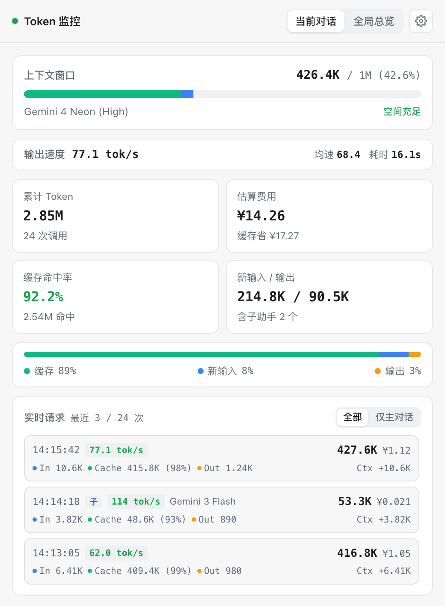
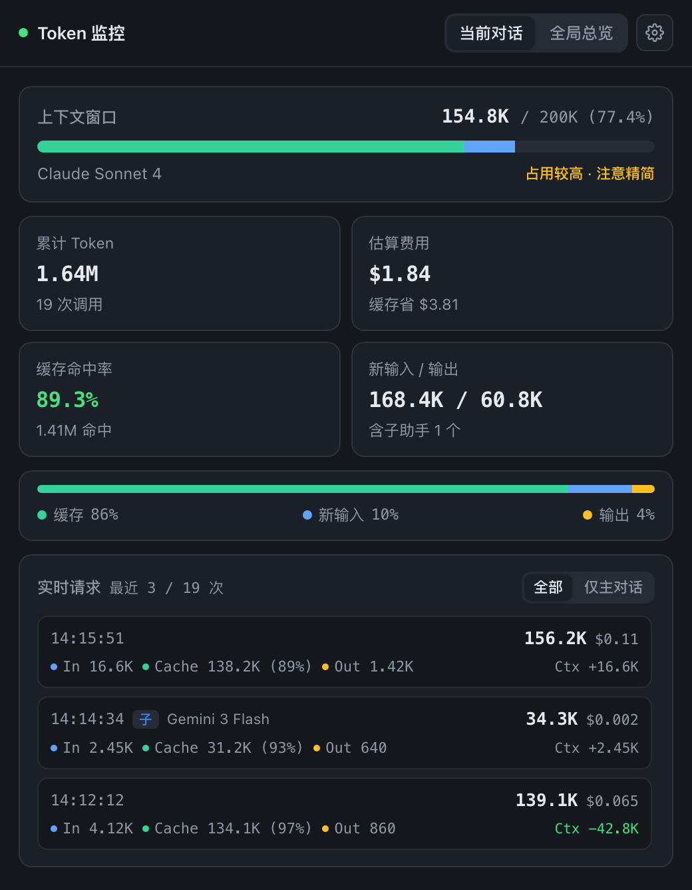
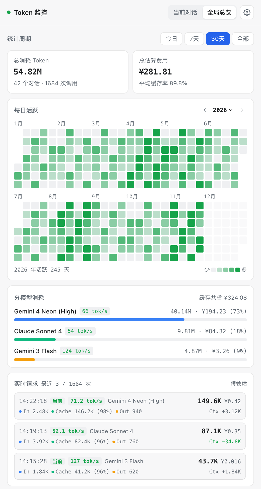
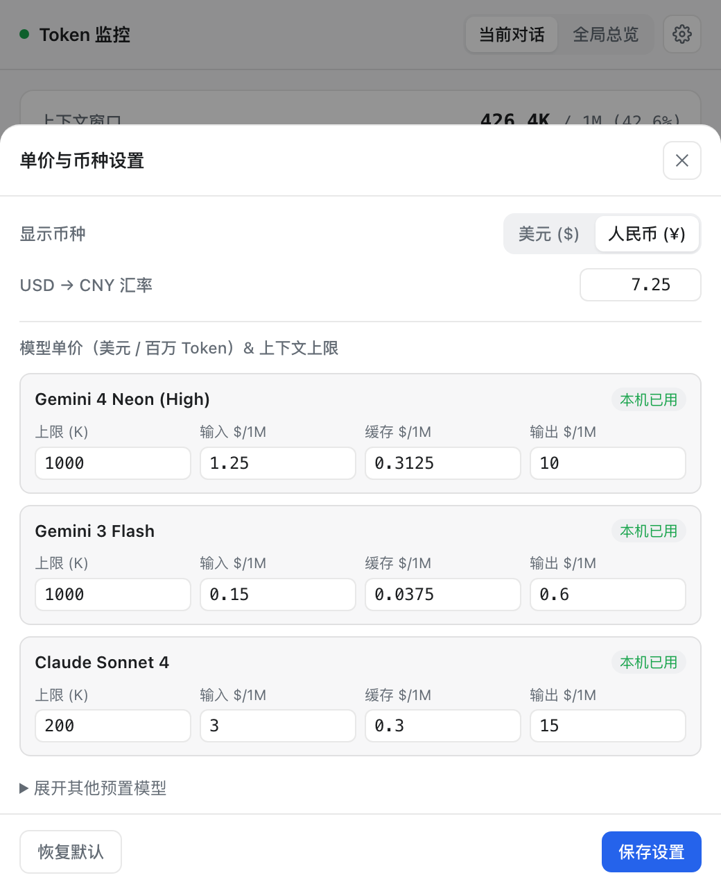

# Antigravity Token Monitor

<p align="center">
  
</p>

极简、实时、零依赖的 **Antigravity** 辅助侧边栏 Token 监控插件。自动追踪当前对话与全局历史会话的上下文窗口占用、端到端输出速度、Token 消耗、缓存命中率、年度每日活跃热力图与估算费用，并支持单日下钻查账、自定义模型单价与币种切换。

---

## 界面预览

> 以下为插件真实界面渲染效果（使用示例数据展示，支持浅色 / 深色主题自动同步与 `$` / `¥` 币种切换）：

<table>
  <tr>
    <td align="center" width="50%">
      
      <br />
      <sub><b>当前对话（浅色主题 · 人民币）</b><br />上下文进度条、输出速度栏、核心指标与逐次实时请求明细</sub>
    </td>
    <td align="center" width="50%">
      
      <br />
      <sub><b>当前对话（深色主题 · 美元 · 占用预警）</b><br />自动同步宿主深色主题，超 70% / 90% 预警、速度色阶与上下文变化</sub>
    </td>
  </tr>
  <tr>
    <td align="center" width="50%">
      
      <br />
      <sub><b>全局总览（12 个月热力图 · 分模型均速 · 单日下钻）</b><br />全年每日活跃度一屏全览、跨年对比切换、各模型均速与跨会话调用流</sub>
    </td>
    <td align="center" width="50%">
      
      <br />
      <sub><b>单价与币种设置抽屉</b><br />自动识别本机已用模型，支持自定义单价、上下文上限与汇率</sub>
    </td>
  </tr>
</table>

---

## 目录

- [界面预览](#界面预览)
- [功能特性](#功能特性)
- [环境要求](#环境要求)
- [安装指南](#安装指南)
  - [方式一：全局安装（推荐）](#方式一全局安装推荐)
  - [方式二：工作区级安装](#方式二工作区级安装)
  - [方式三：软链接安装（本地开发推荐）](#方式三软链接安装本地开发推荐)
- [使用说明](#使用说明)
  - [打开监控面板](#打开监控面板)
  - [当前对话视图](#当前对话视图)
  - [全局总览视图](#全局总览视图)
  - [自定义单价、上下文上限与币种](#自定义单价上下文上限与币种)
- [预置模型参考单价](#预置模型参考单价)
- [独立运行与本地预览](#独立运行与本地预览)
- [目录结构与 API](#目录结构与-api)
- [数据来源与隐私说明](#数据来源与隐私说明)
- [更新与卸载](#更新与卸载)
- [常见问题](#常见问题)
- [开源协议](#开源协议)

---

## 功能特性

- **当前对话实时监控**：自动跟随当前激活的对话（约 1.8 秒轮询 + ETag 增量比对），实时展示上下文窗口占用进度条、模型状态预警、**端到端输出速度栏（`tok/s`、会话均速与耗时，自动排除后台长任务等待避免速率失真）**、累计 Token、估算费用、缓存节省金额、缓存命中率、新输入/输出明细、Token 构成比例与**逐次实时请求消耗流**。
- **子助手 / Swarm 消耗聚合**：自动识别并递归汇总当前会话中通过 `invoke_subagent`、`swarm`、`run_workflow`、`send_message` 等派生的子会话 Token 与费用消耗，支持在实时请求列表中按 `全部 / 仅主对话` 筛选。
- **全局总览与 12 个月每日活跃热力图**：支持按 **今日 / 7天 / 30天 / 全部** 切换时间范围（约 3 秒轮询 + ETag 缓存）；内置上排 `1–6 月` + 下排 `7–12 月` **双排等比年度热力图**（零横向滚动、支持 `‹ 年份 ▾ ›` 跨多年总量对比与任意单日一键下钻），同步查看分模型消耗排行、**各模型加权输出均速**与**跨会话实时请求流**。
- **自定义单价与币种**：内置设置抽屉（支持 `Esc` 快捷关闭），支持自定义各模型的上下文上限与输入/缓存/输出单价（空值自动保留原配置，不误清零），并支持在 **美元 (`$`)** 与 **人民币 (`¥`)** 之间一键切换与自定义汇率。
- **宿主主题自适应**：通过 Antigravity `/preload.js` 自动同步宿主界面的浅色 / 深色主题，视觉无缝融合。
- **零外部依赖 & 纯本地只读**：后端仅使用 Node.js 原生标准库，前端为纯原生 HTML/CSS/JS，无需 `npm install`，无任何外部网络请求。

---

## 环境要求

- **Antigravity**：支持插件与 Sidecar 辅助侧边栏（Auxiliary Pane）的版本（如 Antigravity 2.0+）。
- **Node.js**：推荐 **Node.js 18+**（需支持原生 ESM 与 `structuredClone`），且 `node` 命令在系统 `PATH` 中可用。
- **Git**：用于克隆和更新仓库（也可直接下载 ZIP 解压）。

---

## 安装指南

本项目零第三方依赖，将仓库放置到 Antigravity 的插件发现目录即可直接使用，无需构建或安装 npm 包。

> **注意事项**：
> - **目录名不可修改**：无论通过 `git clone`、软链接还是下载 ZIP 解压安装，插件文件夹名都**必须保持为 `antigravity-token-monitor`**（不要保留 `-main` 后缀或重命名），否则内置 Skill 的一键唤起链接（`sidecar://antigravity-token-monitor/token_monitor/`）会失效。
> - **适用客户端**：Sidecar 侧边栏面板适用于 **Antigravity 桌面端 / IDE**；如果你在终端使用 `agy` CLI，可先使用下方[独立运行与本地预览](#独立运行与本地预览)模式在浏览器查看。

### 方式一：全局安装（推荐）

安装到全局配置目录后，所有工作区和对话中均可使用该插件。

**macOS / Linux：**

```bash
mkdir -p ~/.gemini/config/plugins
git clone https://github.com/OriginNull/antigravity-token-monitor.git ~/.gemini/config/plugins/antigravity-token-monitor
```

**Windows (PowerShell)：**

```powershell
New-Item -ItemType Directory -Force -Path "$env:USERPROFILE\.gemini\config\plugins"
git clone https://github.com/OriginNull/antigravity-token-monitor.git "$env:USERPROFILE\.gemini\config\plugins\antigravity-token-monitor"
```

### 方式二：工作区级安装

如果只想在某个特定项目内启用，或希望与团队共享插件配置，可以安装到项目根目录的 `.agents/plugins/` 下：

```bash
mkdir -p .agents/plugins
git clone https://github.com/OriginNull/antigravity-token-monitor.git .agents/plugins/antigravity-token-monitor
```

> **提示**：UI Sidecar 面板在全局插件目录（`~/.gemini/config/plugins/`）下发现与常驻最稳定，日常使用建议优先选择**方式一**或**方式三**。

### 方式三：软链接安装（本地开发推荐）

如果你正在本地修改或二次开发本插件，建议先克隆到常用代码目录，再创建软链接到全局插件目录：

```bash
git clone https://github.com/OriginNull/antigravity-token-monitor.git /path/to/antigravity-token-monitor
mkdir -p ~/.gemini/config/plugins
ln -s /path/to/antigravity-token-monitor ~/.gemini/config/plugins/antigravity-token-monitor
```

### 启用与确认

1. 放入目录后，Antigravity 会自动发现并默认启用该插件。
2. 你可以在 Antigravity 左侧 **Skills & Customizations**（插件 / 自定义管理）页面中检查 **Antigravity Token Monitor** 是否已开启。
3. 首次安装或升级重启 Antigravity 后，Sidecar 后端会自动在后台启动，但右侧辅助栏**通常不会自动弹出面板**，请按下方方式手动拉出一次。

---

## 使用说明

### 打开监控面板

支持以下两种方式打开面板：

1. **在对话中一键唤起（推荐，首次安装或升级重启后最稳妥）**：插件内置了配套 Skill，直接在聊天框发送以下任意指令，点击 Agent 返回的 **Antigravity Token Monitor** 快捷入口即可立刻拉出右侧栏面板：
   - `打开 Token 监控侧边栏面板`
   - `查看当前对话的上下文占用和缓存命中率`
   - `统计今天和本周各个模型的 Token 消耗与费用`
2. **直接从侧边栏切换**：当面板已在当前窗口打开过，或右侧辅助栏（Auxiliary Pane）有对应标签页时，直接点击切换到 **Antigravity Token Monitor** 即可。

### 当前对话视图

面板顶部默认处于 **当前对话** 标签页，展示当前激活会话的实时状态：

- **上下文窗口进度条**：显示当前对话最近一次模型调用的上下文占用量（`缓存读取 + 新输入`）与模型窗口上限的占比，并根据占用率自动给出状态提示：
  - `< 70%`：**空间充足**
  - `70% ~ 90%`：**占用较高 · 注意精简**
  - `≥ 90%`：**接近上限 · 建议 `/compact`**
- **输出速度栏**：展示最近一次有效调用的端到端输出速度（`tok/s`，含思考与首字等待）、会话加权均速（自动排除 `< 20` Token 短回复与 `> 120s` 异常挂起样本）以及最近单次耗时。
- **核心指标卡（2×2）**：
  - **累计 Token**：当前对话及所有关联子助手的累计 Token 总量与模型调用次数。
  - **估算费用**：按当前单价配置估算的总费用，下方同步展示因 Prompt Cache 节省的金额。
  - **缓存命中率**：计算公式为 `缓存读取 / (新输入 + 缓存读取)`，下方显示缓存命中的 Token 总量。
  - **新输入 / 输出**：分别展示非缓存新输入 Token 与模型输出 Token，下方显示聚合的关联子助手数量。
- **Token 构成比例条**：以三段式色条直观呈现 `缓存`、`新输入`、`输出` 三类 Token 的占比分布。
- **实时请求明细**：按时间倒序展示最近 100 次请求的逐笔消耗，突出本次总 Token、单次费用与单步输出速度（`tok/s`，支持快/慢色阶提示与悬停查看耗时），并拆解 `In` / `Cache (命中率)` / `Out` 及相对同会话上次请求的上下文净变化量（`Ctx +xxx` / 压缩后绿字显示 `Ctx -xxx`）；存在子助手调用时支持一键切换 `全部 / 仅主对话`。

### 全局总览视图

点击顶部 **全局总览** 切换至跨会话统计面板：

- **统计周期切换**：支持一键切换 `今日`、`7天`、`30天`、`全部`。
- **汇总卡片**：展示所选周期（或选定单日）的总消耗 Token、对话数、总调用次数、总估算费用与平均缓存命中率。
- **年度每日活跃热力图（12 个月一屏全览）**：采用上排 1–6 月 + 下排 7–12 月双排等比方格布局，零横向滚动即可一览全年每日用量热度；支持固定宽度 `‹ 年份 ▾ ›` 跨年切换与多年总量对比（支持 10 年以上跨度），悬停任意方格实时查看当日 Token 与费用，点击方格一键下钻筛选当日汇总、分模型消耗与请求流。
- **分模型消耗排行**：按总 Token 消耗降序展示各个模型的 Token 数量、估算费用、**加权平均输出速度（`tok/s`）**与占比进度条，并在标题右侧汇总周期内缓存共节省金额。
- **跨会话实时请求**：实时汇总所选周期或指定单日内跨全部对话的逐次请求消耗，自动标注当前对话（`当前` 徽标）、单步输出速度（`tok/s`）、模型名、`In / Cache / Out` 明细与上下文净变化量（`Ctx +/-`）。

### 自定义单价、上下文上限与币种

点击面板右上角的齿轮图标（⚙）打开设置抽屉：

1. **显示币种**：支持在 **美元 (`$`)** 与 **人民币 (`¥`)** 之间切换，并可自定义 `USD → CNY` 汇率（默认 `7.25`）。
2. **模型单价与上下文上限**：
   - 自动扫描本机历史对话中实际使用过的模型，置顶展示并标注 **本机已用** 标签。
   - 点击 **展开其他预置模型** 可调整其余内置模型的参数。
   - 每个模型均可自定义：**上限 (K)**、**输入 (`$/1M`)**、**缓存 (`$/1M`)**、**输出 (`$/1M`)**。
3. **保存与重置**：点击 **保存设置** 立即生效并持久保存；点击 **恢复默认** 可一键重置为出厂配置。

---

## 预置模型参考单价

以下为插件内置的默认参考单价（单位：美元 / 百万 Token）与默认上下文窗口上限：

| 模型 ID | 上下文上限 | 输入 (`$/1M`) | 缓存读取 (`$/1M`) | 输出 (`$/1M`) |
| :--- | :---: | :---: | :---: | :---: |
| `gemini-4-neon-high` | 1M | 1.25 | 0.3125 | 10.00 |
| `gemini-4-neon` | 1M | 1.25 | 0.3125 | 10.00 |
| `gemini-3-pro` | 1M | 1.25 | 0.3125 | 10.00 |
| `gemini-3-flash` | 1M | 0.15 | 0.0375 | 0.60 |
| `gemini-2.5-pro` | 1M | 1.25 | 0.3125 | 10.00 |
| `gemini-2.5-flash` | 1M | 0.15 | 0.0375 | 0.60 |
| `gemini-2.5-flash-lite` | 1M | 0.075 | 0.01875 | 0.30 |
| `claude-opus-4` | 200K | 15.00 | 1.50 | 75.00 |
| `claude-sonnet-4` | 200K | 3.00 | 0.30 | 15.00 |
| 其他未知模型（Fallback） | 1M | 1.25 | 0.3125 | 10.00 |

> **提示**：
> - 未精确命中的模型 ID 会按**最长前缀优先**（如 `gemini-2.5-flash-lite-preview` 优先匹配 `gemini-2.5-flash-lite` 而非 `gemini-2.5-flash`）与关键词（`flash-lite`、`flash`、`opus`、`sonnet`）进行智能回退匹配。
> - 内置单价仅用于本地估算参考，实际计费请以模型提供商官方账单为准，你随时可以在设置抽屉中按需修改。

---

## 独立运行与本地预览

除了作为 Antigravity Sidecar 运行外，后端还内置了独立 HTTP Server 降级模式，方便开发调试或直接在浏览器查看本机 Token 统计：

```bash
node sidecars/token_monitor/main.mjs
```

启动后在浏览器访问：

```text
http://127.0.0.1:3456
```

- **自定义端口**：可通过 `PORT` 环境变量指定监听端口，例如：
  ```bash
  PORT=8080 node sidecars/token_monitor/main.mjs
  ```
- **查看指定对话**：可在 URL 中附加查询参数 `?conversationId=<对话UUID>`；未指定时默认自动定位本机最近活跃的对话。

---

## 目录结构与 API

### 项目结构

```text
antigravity-token-monitor/
├── plugin.json                              # Antigravity 插件清单
├── assets/
│   ├── logo.svg                             # 插件图标
│   ├── preview-current-light.png            # 界面预览：当前对话（浅色）
│   ├── preview-current-dark.png             # 界面预览：当前对话（深色）
│   ├── preview-overview-light.png           # 界面预览：全局总览
│   └── preview-settings-light.png           # 界面预览：单价与币种设置
├── skills/
│   └── antigravity-token-monitor/
│       └── SKILL.md                         # 配套 Skill（对话唤起侧边栏链接）
├── sidecars/
│   └── token_monitor/
│       ├── sidecar.json                     # Sidecar 启动与辅助侧边栏 UI 注册配置
│       ├── package.json                     # ESM 模块声明（无外部依赖）
│       ├── main.mjs                         # Node.js 后端服务（转录日志解析、缓存、定价 API）
│       ├── index.html                       # 监控面板页面结构
│       ├── styles.css                       # 自适应浅色/深色主题样式
│       └── app.js                           # 前端轮询、渲染与设置抽屉逻辑
├── LICENSE                                  # Apache-2.0 许可证
└── README.md                                # 项目说明文档
```

### 本地 HTTP API

| 方法与路径 | 说明 |
| :--- | :--- |
| `GET /api/current?conversationId=<id>&etag=<etag>` | 获取当前对话及子会话的上下文占用、Token 汇总与逐次实时请求快照；数据未变化时返回 `{ "unchanged": true }` |
| `GET /api/overview?range=today\|7d\|30d\|all&year=<YYYY>&date=<YYYY-MM-DD>&etag=<etag>` | 获取指定周期（或指定单日 `date`）的全局汇总、分模型统计、跨会话请求流以及指定年份 `year` 的 12 个月每日热力图数据；无变化返回 `{ "unchanged": true }` |
| `GET /api/pricing` | 获取当前币种、汇率、兜底规则及所有预置/本机已用模型单价 |
| `POST /api/pricing` | 保存自定义单价与币种配置；传入 `{ "reset": true }` 恢复默认配置 |

---

## 数据来源与隐私说明

- **只读扫描**：插件仅以只读方式解析本地 Antigravity 对话转录日志：
  ```text
  <appData>/brain/<conversationId>/.system_generated/logs/transcript.jsonl
  ```
  绝不会修改、删除或干扰任何对话数据。
- **高性能低开销**：后端基于文件的 `mtime + size` 维护 LRU 内存解析缓存（上限 1000 条）与多维度总览缓存（按周期 / 年份 / 单日维度缓存，上限 16 组），前端配合 `ETag` 进行差异轮询、请求序号防竞态并在页面隐藏时暂停轮询，空闲时几乎零 CPU 占用。
- **配置与速度观测持久化路径**：
  - 在 Antigravity Sidecar 模式下，自定义单价保存在 `<ANTIGRAVITY_EXECUTABLE_DATA_DIR>/pricing.json`，实时捕获的纯文本回复耗时缓存在同目录 `timings.json`（均采用原子写入，防止异常中断损坏文件）。
  - 在独立运行模式下，保存在 `sidecars/token_monitor/pricing.json` 与 `sidecars/token_monitor/timings.json`。
- **纯本地运行**：所有统计计算均在本机完成，不联网、不上传任何会话内容或统计数据。

---

## 更新与卸载

### 更新插件

进入安装目录拉取最新代码即可（你的自定义单价配置保存在独立的 `pricing.json` 中，不会被覆盖）：

```bash
cd ~/.gemini/config/plugins/antigravity-token-monitor
git pull
```

> **重要**：由于 Sidecar 后端（`main.mjs`）为常驻进程，拉取更新后请在 Antigravity 的 **Skills & Customizations** 页面将 **Antigravity Token Monitor** **关闭再重新开启**（或重启 Antigravity），以重启后端进程使新版本完全生效。

### 卸载插件

1. 在 Antigravity 的 **Skills & Customizations** 页面中禁用或卸载 **Antigravity Token Monitor**；
2. 或直接删除插件目录：
   ```bash
   rm -rf ~/.gemini/config/plugins/antigravity-token-monitor
   ```

---

## 常见问题

**1. 首次安装或更新 Antigravity 后，右侧栏看不到监控面板 / 感觉服务没了？**
- Antigravity 更新或重启后，虽然 Sidecar 后端已经在后台正常启动，但右侧辅助栏的旧标签页会被重置收起，**不会自动弹出**。
- 直接在聊天框发送 `打开 Token 监控侧边栏面板`，点击 Agent 返回的快捷链接即可一键重新拉出面板。
- 如果点击快捷链接无反应，请确认：
  1. 插件在 **Skills & Customizations** 中处于开启状态；
  2. 安装目录名严格为 `antigravity-token-monitor`（切勿重命名或保留 ZIP 解压后的 `-main` 后缀）。

**2. 面板一直显示“等待对话产生 Token 记录”？**
- 请先在当前对话中发送一条消息并等待模型完成回复，面板会自动刷新。
- 若使用独立模式运行，请确认本机 `~/.gemini/*/brain/` 下存在历史对话日志。

**3. 右上角状态圆点变暗 / 面板无法连接？**
- 请确认系统已安装 Node.js 18+ 且 `node` 命令在环境变量 `PATH` 中可正常执行。
- 若刚安装或更新插件，可尝试在插件管理页关闭后重新开启，或重启 Antigravity。

**4. 为什么上下文占用量比累计 Token 小很多？**
- **上下文窗口占用** 反映的是 **最近一次调用** 实际送入模型的上下文长度（`缓存读取 + 新输入`），决定了是否接近模型单次窗口上限；
- **累计 Token** 反映的是整个对话（含多轮交互与子助手）所有调用累加的总消耗量。

**5. 如何判断什么时候该压缩上下文？**
- 当上下文占用进度条达到 **70%** 以上时面板会提示注意精简；达到 **90%** 以上时会高亮提示建议使用 `/compact` 命令整理上下文，以降低延迟并避免超出窗口上限。

**6. 如何查看历史上某一天（或跨多年）的具体用量？**
- 切换到顶部 **全局总览**，中间的 **每日活跃热力图** 会将全年 12 个月以双排（上排 1–6 月、下排 7–12 月）一屏铺满展示。
- 鼠标悬停任意日期方格即可实时查看当日 Token 与估算费用；点击该方格后，汇总卡片、分模型消耗与实时请求流都会同步下钻到当天，点击右上角 **返回全局** 或再次点击同一方格即可恢复。
- 若存在跨多年历史记录，点击热力图右上角 **`‹ 年份 ▾ ›`** 即可翻年或展开年度清单，一眼对比各年总量并一键跳转。

**7. 为什么某些单步请求不显示输出速度，或耗时前带有 `~`？**
- 面板计算的是模型端到端生成速率，自动排除 `SYSTEM_MESSAGE`（如后台打包/子任务完成通知、定时唤醒）与人工思考等待时间，避免把长任务耗时误算进模型速度导致速率暴跌。
- 历史纯文本回复若未曾被 `fs.watch` 实时观测到落盘时刻，则置空跳过而不污染均速；极快同秒工具调用会以 `~1.0s` 标注同秒估算值且不计入均速分母。

---

## 开源协议

本项目基于 [Apache License 2.0](LICENSE) 开源。
